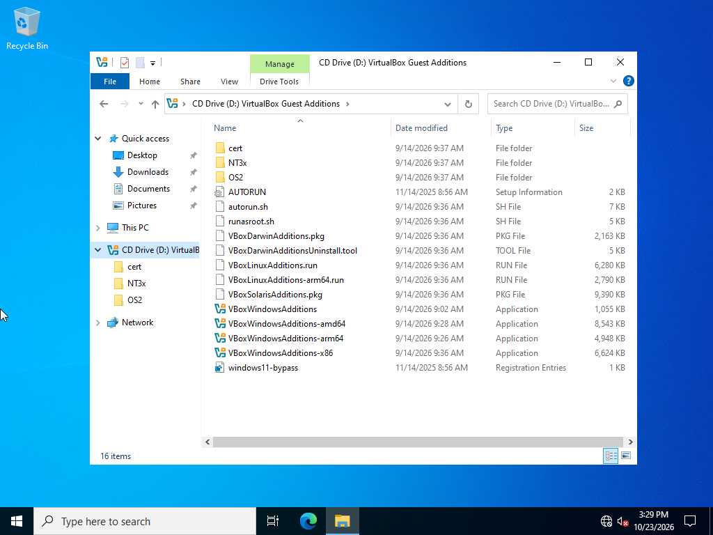

# Lab 1: Building the server VM

The first step was a Windows Server 2022 VM in VirtualBox. This is the machine that becomes the domain
controller in [Lab 3](03-domain-controller.md).

## Checking my PC first

Before making anything I checked what I had to work with:

- 12 CPU cores and about 15 GB of RAM, so giving the VM 2 cores and 4 GB was fine.
- My main drive only had about 40 GB free, so a 50 GB virtual disk wouldn't fit. My second drive had over
  700 GB free, so the VM went there. (I didn't do this for my Windows 10 VM, and it came back to bite me later.
  See [the disk-full incident](../incidents/01-host-disk-full.md).)

## The VM settings

| Setting | What I picked | Why |
|---|---|---|
| OS | Windows Server 2022 Evaluation | Free for 180 days, plenty for a lab |
| CPUs | 2 | Enough for a small domain controller |
| RAM | 4 GB | Leaves plenty for my PC and the Windows 10 VM |
| Disk | 50 GB, fixed size | Fixed takes the full space up front but runs a bit faster |
| Firmware | EFI | Recommended for Server 2022 |
| Network | Host-only to start | Changed to NAT + internal network in [Lab 2](02-lab-network.md) |
| Stored on | My second drive (`/mnt/storage/vms`) | Main drive didn't have room |

<details>
<summary>Show the main commands</summary>

I built the VM from the command line with `VBoxManage` (VirtualBox's command-line tool) while getting help.
These are the three main steps. Clicking through the VirtualBox wizard with the same settings gives the same result.

```bash
# 1. Create an empty VM and add it to VirtualBox
VBoxManage createvm --name WinServer2022 --ostype Windows2022_64 \
  --basefolder /mnt/storage/vms --register

# 2. Give it 2 CPUs, 4 GB RAM and EFI
#    (I also set display, network and boot order settings, left out here)
VBoxManage modifyvm WinServer2022 --cpus 2 --memory 4096 --firmware efi

# 3. Make the 50 GB virtual disk (size is in MB)
VBoxManage createmedium disk \
  --filename /mnt/storage/vms/WinServer2022/WinServer2022.vdi \
  --size 51200 --format VDI --variant Fixed
```

After that, the disk and the Windows ISO get attached to the VM, and it's ready to start.

</details>

## Installing Windows

- When it says "Press any key to boot from CD or DVD" you have to click into the window and press a key quickly.
- On the edition screen I picked **Standard Evaluation (Desktop Experience)**. The one without "Desktop Experience"
  is Server Core, which has no desktop at all, only a command line. Easy one to get wrong.
- Custom install, pick the 50 GB drive, then set the Administrator password.
- Pressing Ctrl+Alt+Del on my keyboard goes to Linux, not the VM. To get to the login screen I used
  Input > Keyboard > Insert Ctrl-Alt-Del in the VM window (or Right Ctrl + Del).

## Guest Additions

Guest Additions are VirtualBox drivers that go inside the VM. They make the screen resize properly and let the
mouse and copy/paste work between my PC and the VM.

Devices > Insert Guest Additions CD image, then inside Windows open the CD drive, run `VBoxWindowsAdditions.exe`
and reboot. Windows hides file extensions by default, so the installer just showed up as "VBoxWindowsAdditions".

## Snapshot

A snapshot is a save point for the VM. I took one called `fresh-install` of the clean install, so I could go
back if I broke something.

---

## Screenshots

**1.** The Guest Additions installer on the new server. Windows hides the .exe part, so it only shows "VBoxWindowsAdditions" with type Application.


