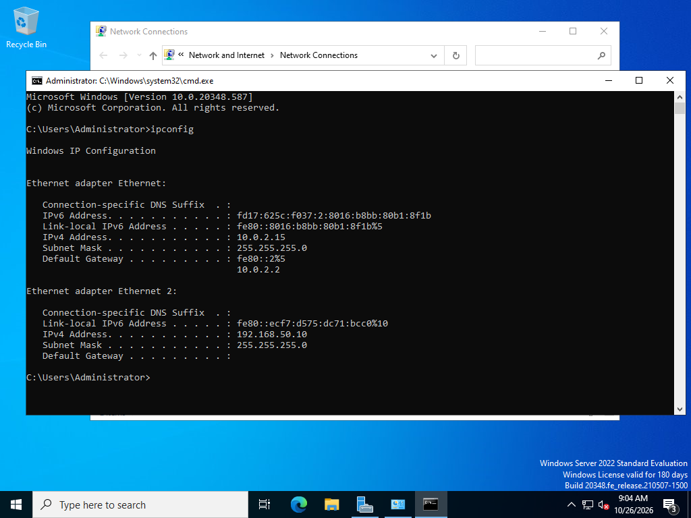
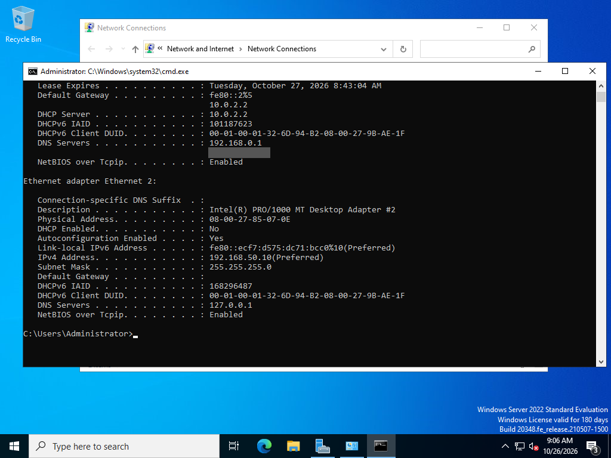
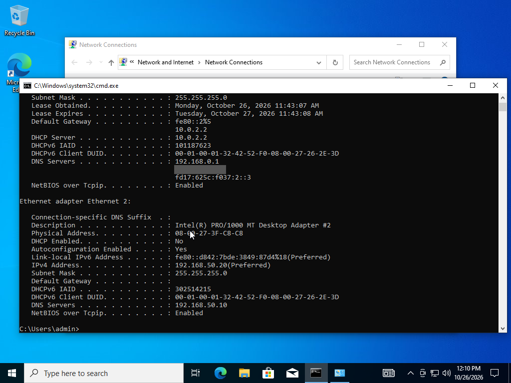
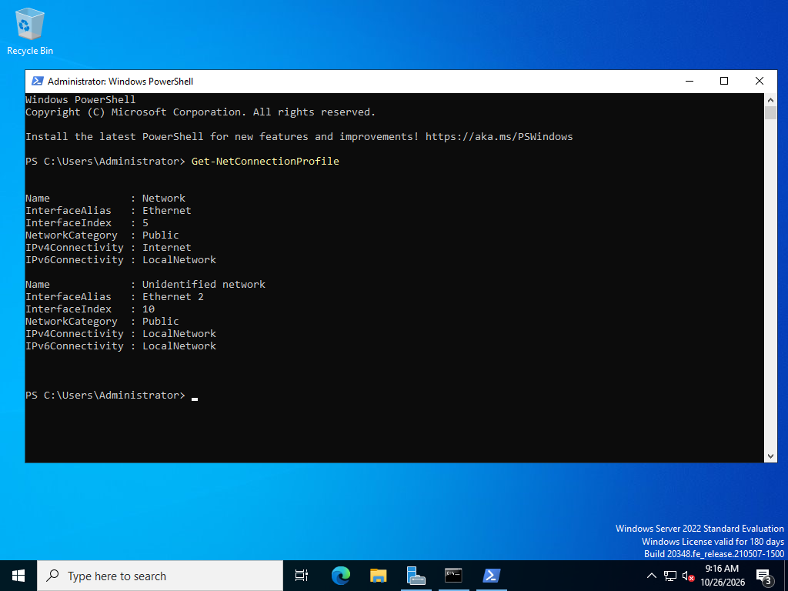
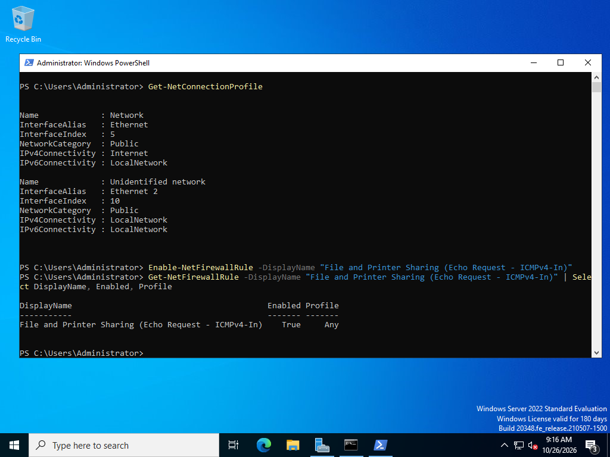
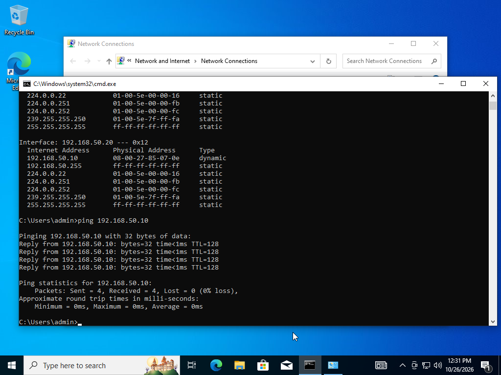

# Lab 2: The lab network

I wanted both VMs to have internet, and also a private network between them where the server could
eventually run the domain. So each VM got two network adapters:

| VM | Adapter 1 | Adapter 2 |
|---|---|---|
| Server (WinServer2022) | NAT (internet) | Internal network "ADLab", 192.168.50.10 |
| Client (Windows 10) | NAT (internet) | Internal network "ADLab", 192.168.50.20 |

- **NAT** gives a VM internet through my PC, kind of like a home router. Each VM gets its own NAT, though, so
  the VMs can't see each other on it.
- **Internal network** is like a private switch that only VMs can plug into. Anything connected to "ADLab" can
  talk to each other. My PC and the internet can't see it.

## Changing the adapters

The VM has to be fully shut down for this. "Saved" doesn't count, it has to be "poweroff":

```bash
VBoxManage showvminfo WinServer2022 --machinereadable | grep VMState
```

Then:

```bash
VBoxManage modifyvm WinServer2022 --nic1 nat --nic2 intnet --intnet2 ADLab --cableconnected2 on

VBoxManage snapshot "windows 10 " take "before-AD-network"
VBoxManage modifyvm "windows 10 " --nic1 nat --nic2 intnet --intnet2 ADLab --cableconnected2 on
```

I took a snapshot of the Windows 10 VM before changing it, just in case. Also, my Windows 10 VM's name has a
space at the end (`"windows 10 "`), which I didn't notice at first. My commands kept failing with "Could not
find a registered machine" until I put the space inside the quotes.

## Static IPs

I set these inside Windows: Win+R, `ncpa.cpl`, right-click the internal adapter, Properties, IPv4.

| Setting | Server | Client |
|---|---|---|
| IP address | 192.168.50.10 | 192.168.50.20 |
| Subnet mask | 255.255.255.0 | 255.255.255.0 |
| Default gateway | blank | blank |
| DNS server | 127.0.0.1 (itself) | 192.168.50.10 (the server) |

Why it's set up this way:

- The server needs an IP that never changes because it's going to be the DNS server, and clients find the
  domain by asking it. There's also no DHCP on this network, so nothing would hand out addresses anyway.
- The gateway is blank because the NAT adapter already handles internet. Two gateways can confuse Windows about
  where to send internet traffic.
- The client uses the server for DNS. If it doesn't, it can't find the domain at all.

I checked everything with `ipconfig /all`.

## Problem: the client couldn't ping the server

`ping 192.168.50.10` from the client just said "Request timed out".

1. I ran `arp -a` on the client. It showed the server's MAC address, so the two VMs could see each other on
   the network. Something on the server was ignoring the ping.
2. On the server, `Get-NetConnectionProfile` showed the internal adapter was set to **Public**. Windows Firewall
   blocks ping on Public networks by default.
3. Instead of turning the firewall off, I turned on the built-in rule that allows ping. I got help with these
   PowerShell commands, since I'm still learning it:

   ```powershell
   Enable-NetFirewallRule -DisplayName "File and Printer Sharing (Echo Request - ICMPv4-In)"
   ```

4. After that the ping worked: 4 out of 4 replies.

Lesson: a ping timeout doesn't always mean the network is broken. It can just be the firewall.

## Snapshot

```bash
VBoxManage snapshot WinServer2022 take "network-configured"
```

---

## Screenshots

**2.** The server's internal adapter with the static IP 192.168.50.10 and no gateway. The NAT adapter (10.0.2.15) handles internet.



**3.** ipconfig /all on the server: DHCP off on the internal adapter and DNS set to 127.0.0.1, because the server will be its own DNS server.



**4.** The client: 192.168.50.20, no gateway, DNS pointing at the server.



**5.** Pings were timing out. The server's internal adapter was on the Public network profile, which blocks ping.



**6.** I turned on the built-in firewall rule for ping instead of turning off the firewall.



**7.** arp -a showed the server's MAC address, so the network was fine. After the firewall change, 4/4 replies.


