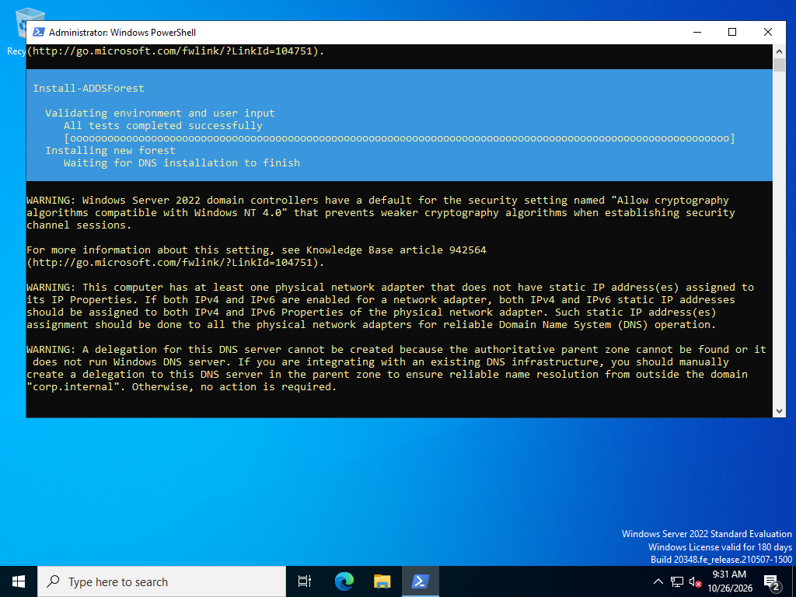
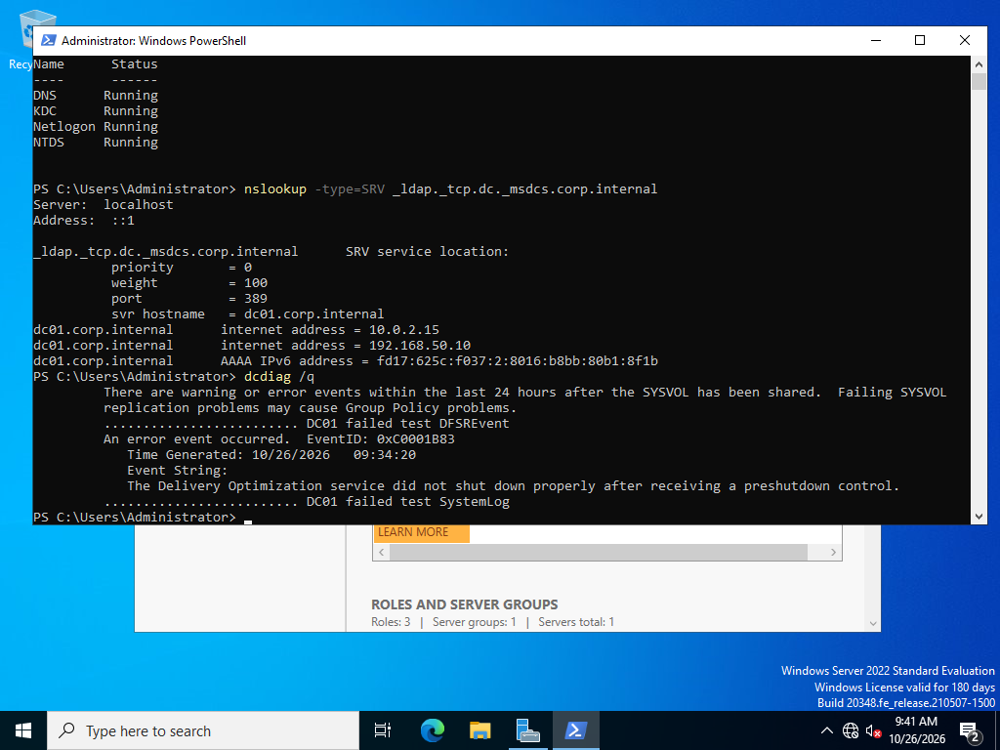
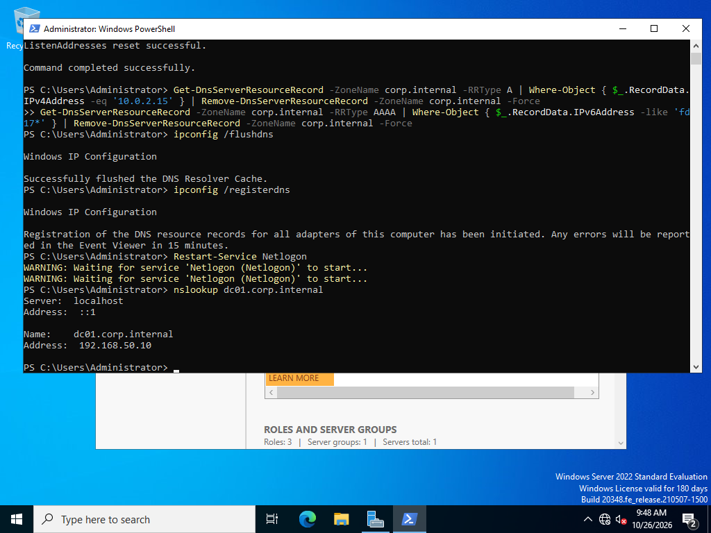

# Lab 3: Making the server a domain controller

A domain controller (DC) is the server that holds Active Directory: all the user accounts, computers, groups and
passwords. Users sign in to the domain instead of to each PC separately.

> I'm still new to PowerShell. For the server setup I followed along with commands while getting help, and
> wrote down what each one does. Most of my day-to-day work in the later tickets was in the GUI.

## Step 1: Rename the server

Windows gave the server a random name like `WIN-8K2J3L4M5N`. I renamed it to DC01 (domain controller #1):

```powershell
Rename-Computer -NewName "DC01" -Restart
```

I did this before installing Active Directory, because renaming a DC afterwards is a lot more work.

## Step 2: Install the AD DS role

```powershell
Install-WindowsFeature AD-Domain-Services -IncludeManagementTools
```

This only installs the software. The server isn't a DC yet. `-IncludeManagementTools` adds the admin tools
like Active Directory Users and Computers (ADUC), which I use a lot in the later labs.

## Step 3: Create the domain

I named the domain `corp.internal`. I read that `.local` causes problems with some devices and that `.internal`
is reserved for private networks, so that's what I went with.

```powershell
Install-ADDSForest -DomainName "corp.internal" -DomainNetbiosName "CORP" -InstallDns
```

- This creates a new domain and makes DC01 its first domain controller.
- `-InstallDns` also sets the server up as a DNS server. Active Directory needs DNS so computers can find the DC.
- It asks for a DSRM password. That's an emergency password for repairing AD, so I saved it somewhere safe.
- It showed two warnings, one about DNS delegation and one about the NAT adapter not having a static IP. Neither
  one matters for a lab like this.

The server rebooted on its own. After that I signed in as `CORP\Administrator`.

## Step 4: Check that it worked

```powershell
Get-Service NTDS, DNS, KDC, Netlogon | Select Name, Status
nslookup dc01.corp.internal
dcdiag /q
```

- All four AD services were running.
- `dcdiag` is a health check for the DC. It showed a couple of errors, but they were from the first reboot and
  are normal on a brand new DC.
- **Problem:** `nslookup dc01.corp.internal` returned **two** IP addresses: the lab one (192.168.50.10) and the
  NAT one (10.0.2.15).

## Step 5: Fixing the second IP in DNS

The DC had registered both of its adapters in DNS. If the client got sent to 10.0.2.15, it wouldn't be able to
reach the DC, so joining the domain or signing in would fail some of the time and work other times.

This one took me a while to figure out. What I ended up doing:

```powershell
# Stop the NAT adapter from adding itself to DNS
Set-DnsClient -InterfaceAlias "Ethernet" -RegisterThisConnectionsAddress $false
Set-DnsClientServerAddress -InterfaceAlias "Ethernet" -ServerAddresses 127.0.0.1

# Make the DNS server only answer on the lab IP
dnscmd /ResetListenAddresses 192.168.50.10

# Delete the wrong record that was already there
Get-DnsServerResourceRecord -ZoneName corp.internal -RRType A |
  Where-Object { $_.RecordData.IPv4Address -eq '10.0.2.15' } |
  Remove-DnsServerResourceRecord -ZoneName corp.internal -Force

# Register again and check
ipconfig /registerdns
nslookup dc01.corp.internal
```

I also deleted a leftover IPv6 address from the NAT adapter the same way. After that, `dc01.corp.internal` only
returned 192.168.50.10. Snapshot: `dc-promoted`.

Honestly the install itself was the easy part. Almost everything that went wrong in this lab and the next one
was DNS. I also wouldn't have caught the two-IP problem if I hadn't run nslookup afterwards.

---

## Screenshots

**8.** Creating the corp.internal domain with Install-ADDSForest. The two warnings are normal for a lab.



**9.** Checks after the promotion. The AD services are running, but dc01 shows two IP addresses, one of which is the NAT address the client can't reach.



**10.** After the fix, dc01.corp.internal only resolves to 192.168.50.10.


