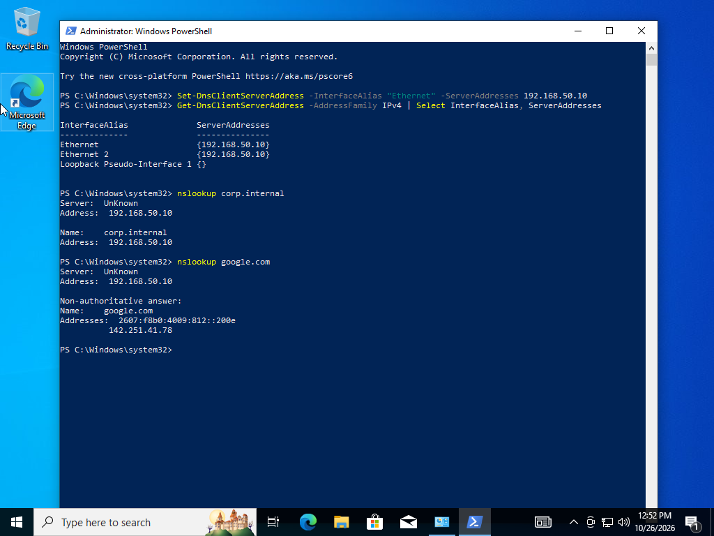
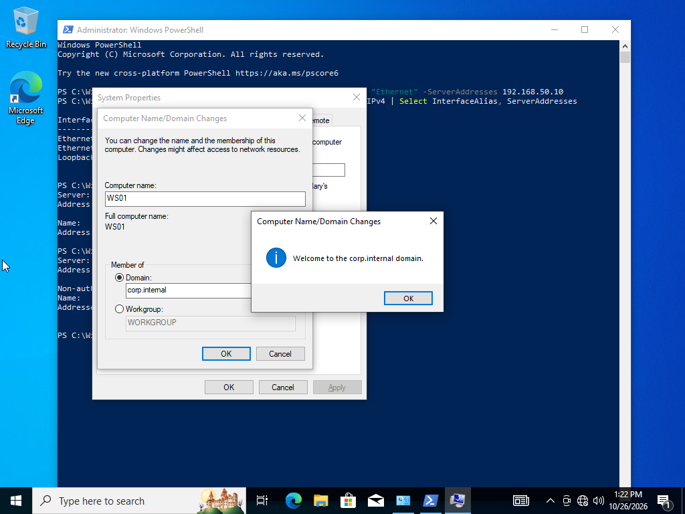
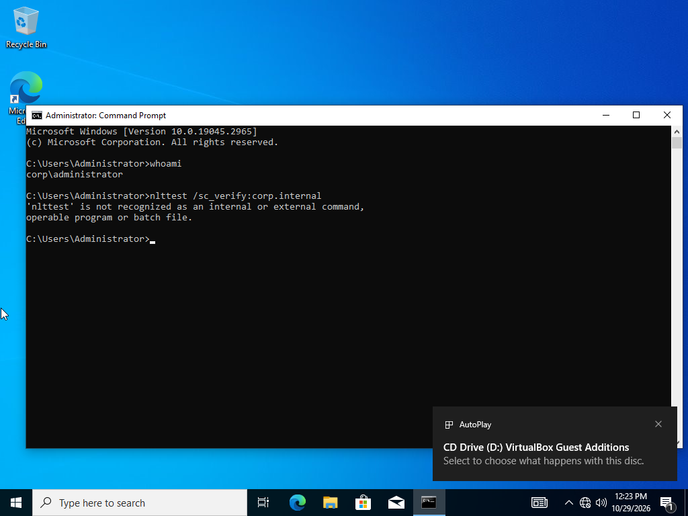
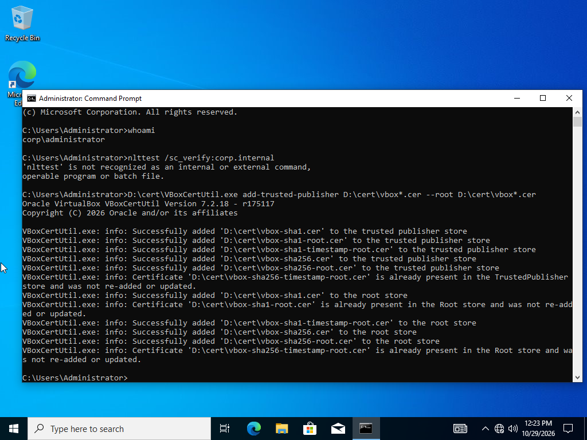
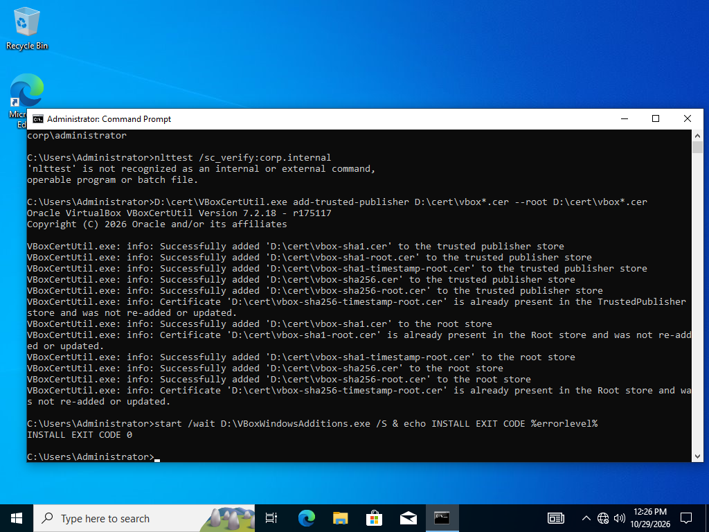
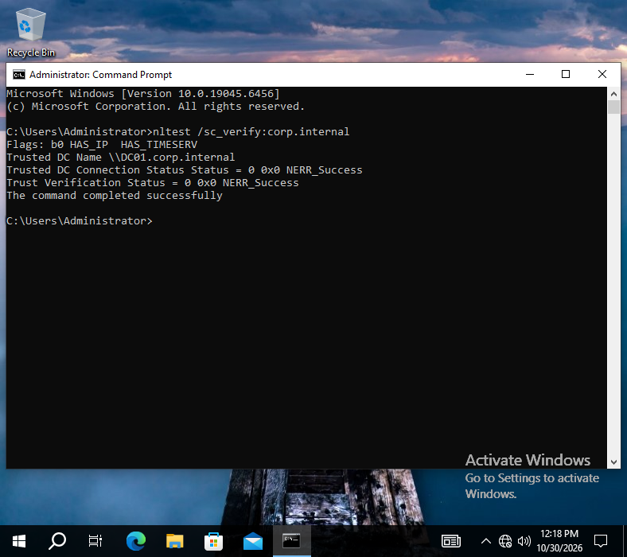
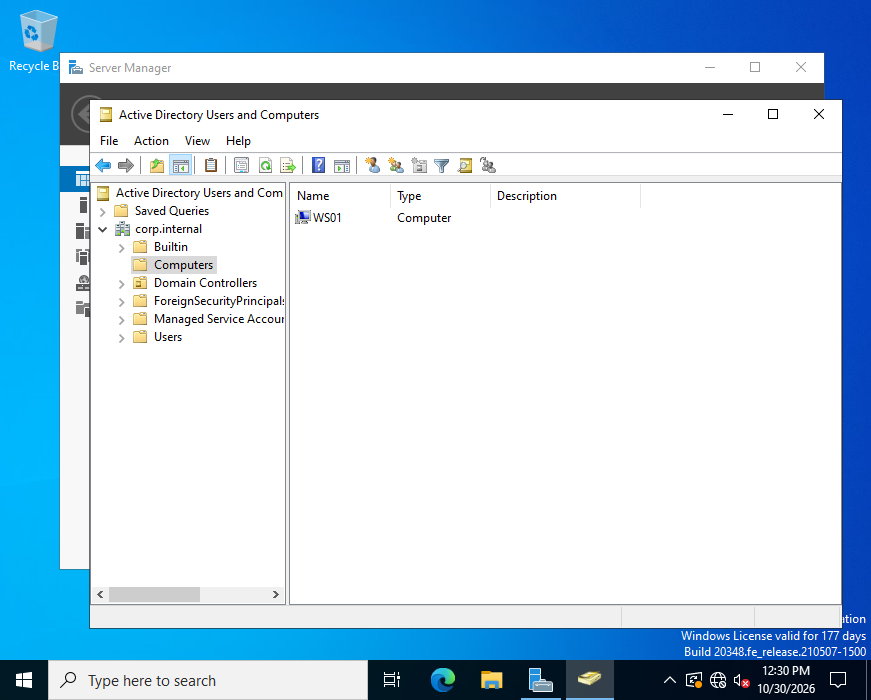

# Lab 4: Joining the Windows 10 PC to the domain

## Step 1: Point the client's DNS at the DC

In Lab 2 I set DNS on the internal adapter, but the NAT adapter was still using my home router for DNS. If
Windows asks the router about `corp.internal`, the router says it doesn't exist and the domain join fails. So I
pointed the NAT adapter at the DC too. Like in Lab 3, I followed along with these commands while getting help:

```powershell
Set-DnsClientServerAddress -InterfaceAlias "Ethernet" -ServerAddresses 192.168.50.10
nslookup corp.internal
nslookup google.com
```

Both worked. `corp.internal` came back as 192.168.50.10, and google.com still worked because the DC looks up
internet names for the client. Snapshot: `dns-ready-before-join`.

## Step 2: Rename the PC and join the domain

Win+R, `sysdm.cpl`, Computer Name tab, Change. I named the PC **WS01** (workstation #1) and set Member of:
Domain to `corp.internal`. It then asks for an account that's allowed to join computers to the domain.

It didn't work the first few times:

| Error | What I did wrong | Fix |
|---|---|---|
| "DNS name contains an invalid character" | I typed the username in the Domain box | Only `corp.internal` goes in that box |
| "The specified username is invalid" | VirtualBox's keyboard wasn't sending the `\` in `CORP\Administrator` correctly | Used `Administrator@corp.internal` instead |

Then I got "Welcome to the corp.internal domain" and restarted.

## Step 3: Copy/paste didn't work

I couldn't paste commands into WS01 even though Shared Clipboard was turned on. On my PC I checked:

```bash
VBoxManage showvminfo "windows 10 " --machinereadable | grep -iE 'clipboard|GuestAdditionsRunLevel'
```

The clipboard was set to bidirectional, but `GuestAdditionsRunLevel=0`, meaning Guest Additions weren't
installed on this VM. The setting only works if Guest Additions are running inside Windows.

Since I couldn't paste, I typed the install commands into the VM from my PC with
`VBoxManage controlvm "windows 10 " keyboardputstring '...'`. The first command trusts Oracle's driver
certificate so the install doesn't stop to ask. `/S` runs the installer without any prompts:

```bat
D:\cert\VBoxCertUtil.exe add-trusted-publisher D:\cert\vbox*.cer --root D:\cert\vbox*.cer
start /wait D:\VBoxWindowsAdditions.exe /S
shutdown /r /t 5
```

After the reboot, copy/paste worked. Snapshot: `domain-joined`.

> Partway through this lab my PC's disk filled up and both VMs crashed. See [the incident write-up](../incidents/01-host-disk-full.md).

## Step 4: Check the join worked

On WS01:

```bat
whoami
nltest /sc_verify:corp.internal
```

- `whoami` showed `corp\administrator`, so I was signed in with a domain account and not a local one.
- `nltest` checks the connection between the PC and the domain. It returned `NERR_Success`. If this connection
  breaks, users get the "trust relationship between this workstation and the primary domain failed" error.
  (My first try said "not recognized" because I typed `nlttest`.)

On DC01, in Active Directory Users and Computers, WS01 now shows up in the Computers folder. Joining the domain
is what created that computer account.

Snapshots: DC01 `lab4-ws01-joined`, WS01 `lab4-verified`. I snapshot both VMs at the same time now, because
restoring only one of them can cause that trust relationship error.

---

## Screenshots

**11.** Both of the client's adapters pointed at DC01 for DNS. corp.internal resolves, and google.com still works.



**12.** Joined to corp.internal after a few failed tries. Using Administrator@corp.internal instead of CORP\Administrator got it through.



**13.** First sign-in on WS01 with the domain account. whoami shows corp\administrator. (The nltest error is my typo.)



**14.** Copy/paste wasn't working, so I typed commands into the VM from my PC. This one trusts Oracle's certificate before installing Guest Additions.



**15.** Installing Guest Additions silently, then rebooting. After this, copy/paste worked.



**16.** nltest returns NERR_Success, so WS01's connection to the domain is working.



**17.** On DC01, WS01 shows up as a computer in Active Directory Users and Computers.


