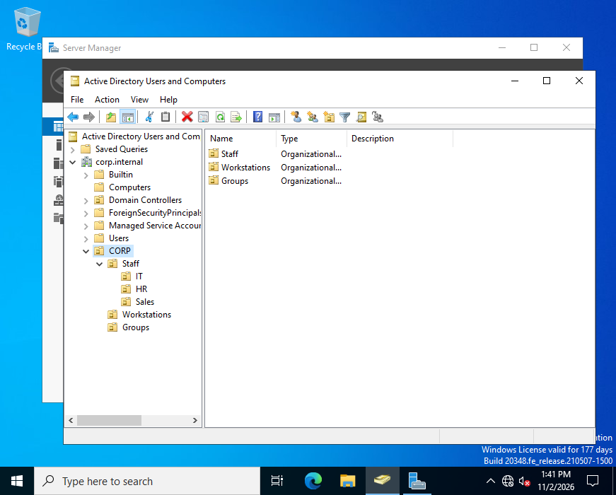
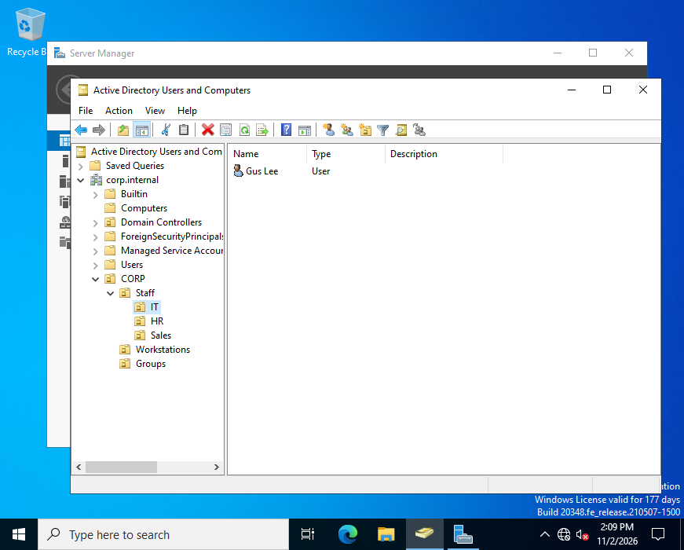
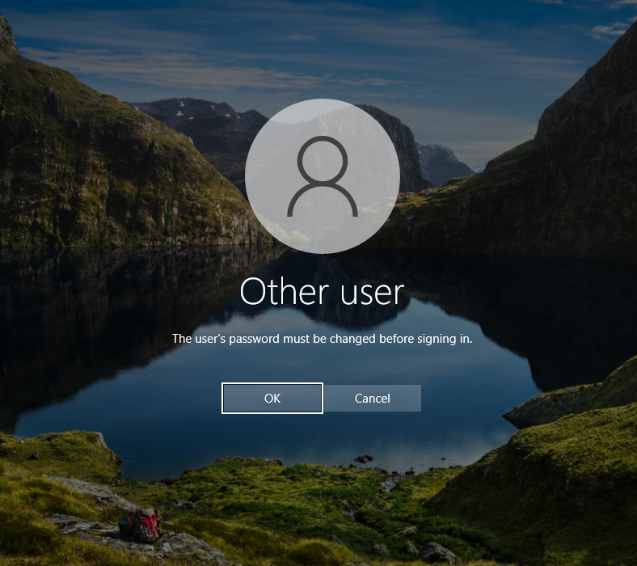
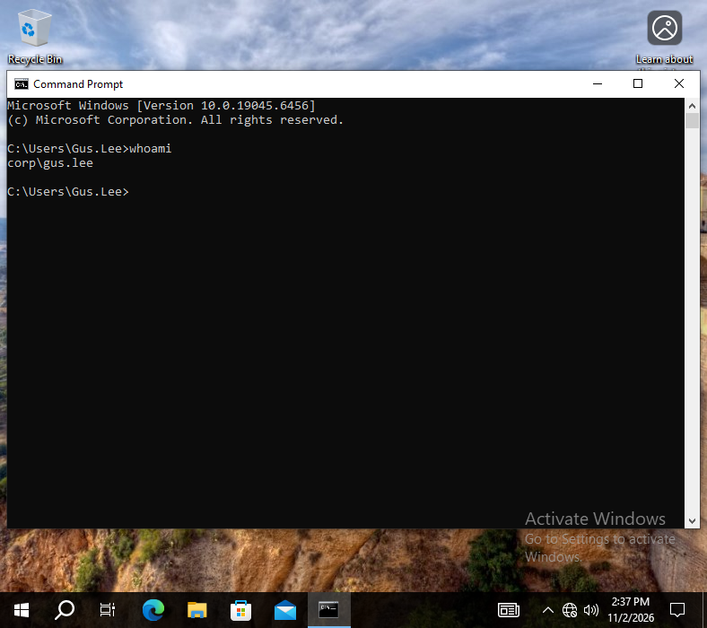

# Lab 5: OUs and users

## The plan

```
corp.internal
└── CORP
    ├── Staff
    │   ├── IT
    │   ├── HR
    │   └── Sales
    ├── Workstations
    └── Groups
```

An OU (organizational unit) is basically a folder in Active Directory. The difference from the built-in folders
like "Computers" and "Users" is that you can apply Group Policy to an OU. That's why I made my own instead of
using the defaults. I called it "Staff" so I wouldn't mix it up with the built-in "Users" folder.

## Step 1: Create the OUs

In ADUC on DC01: right-click `corp.internal` > New > Organizational Unit > `CORP`. Then I made the rest inside it.

I left "Protect container from accidental deletion" ticked. One wrong click could delete a whole OU with
everything in it, so this makes Windows refuse to delete it.

You can tell OUs apart from the built-in folders by the icon: OUs have a little book on the folder.

## Step 2: Move WS01 into Workstations

ADUC > Computers > right-click WS01 > Move > CORP\Workstations.

Moving it doesn't change anything on the PC itself. It just means any Group Policy I link to the Workstations OU
later will apply to WS01.

## Step 3: Create users

I made three test users, one per department, using first.last for the logon name:

| Name | OU | Logon name |
|---|---|---|
| Gus Lee | Staff\IT | Gus.Lee |
| Tommy Emanuel | Staff\HR | Tommy.Emanuel |
| Jason Woo | Staff\Sales | Jason.Woo |

Right-click the OU > New > User, fill in the name and logon name, set a temporary password, and tick
**"User must change password at next logon"**. That way the user picks their own password and I never know it.

## Step 4: First sign-in as a domain user

On WS01 I signed out, clicked Other user and signed in as `Gus.Lee@corp.internal` with the temporary password.

- It said "The user's password must be changed before signing in", so I set a new one.
- The first sign-in was slow because Windows was creating Gus's profile folder (`C:\Users\Gus.Lee`).
- `whoami` showed `corp\gus.lee`. The Command Prompt title didn't say "Administrator", which means Gus is a normal
  user without admin rights on the PC, which is how normal staff accounts should be.

---

## Screenshots

**18.** The OU structure under CORP. The OUs have the book icon, and the built-in folders (Computers, Users) don't.



**19.** WS01 moved into CORP\Workstations.


**20.** Creating a user (Gus Lee in IT) with "User must change password at next logon" ticked.



**21.** Gus's first sign-in on WS01. Windows makes him pick a new password before he can sign in.



**22.** Signed in as Gus. whoami shows corp\gus.lee, and the window title shows he isn't an admin.


