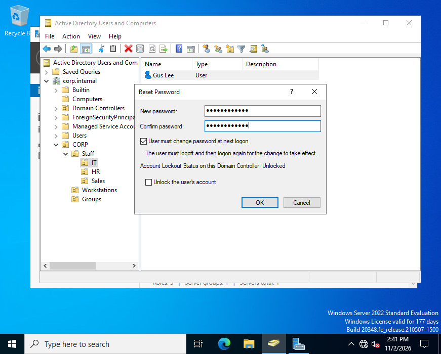

# Ticket #1: Password reset

**Ticket:** "Hi, it's Gus Lee in IT. I forgot my password and can't log in."

1. Confirm it's really Gus first. At a real job this would be something like an employee ID or calling back
   their manager, because someone pretending to be a user is an easy way into an account.
2. On DC01, open ADUC > CORP\Staff\IT > right-click Gus Lee > Reset Password.
3. Enter a temporary password and tick "User must change password at next logon".
4. Give Gus the temporary password. When he signs in, Windows makes him pick a new one.

Things I noticed:

- A **reset** is when an admin sets a new password without knowing the old one. A **change** is when the user
  does it themselves and types the old one first.
- The reset window also has an "Unlock the user's account" checkbox. That came in handy in ticket #2.

Gus signed in with the temporary password, set a new one and got to his desktop. Ticket closed.

---

## Screenshots

**23.** Resetting Gus's password in ADUC with "User must change password at next logon" ticked.

