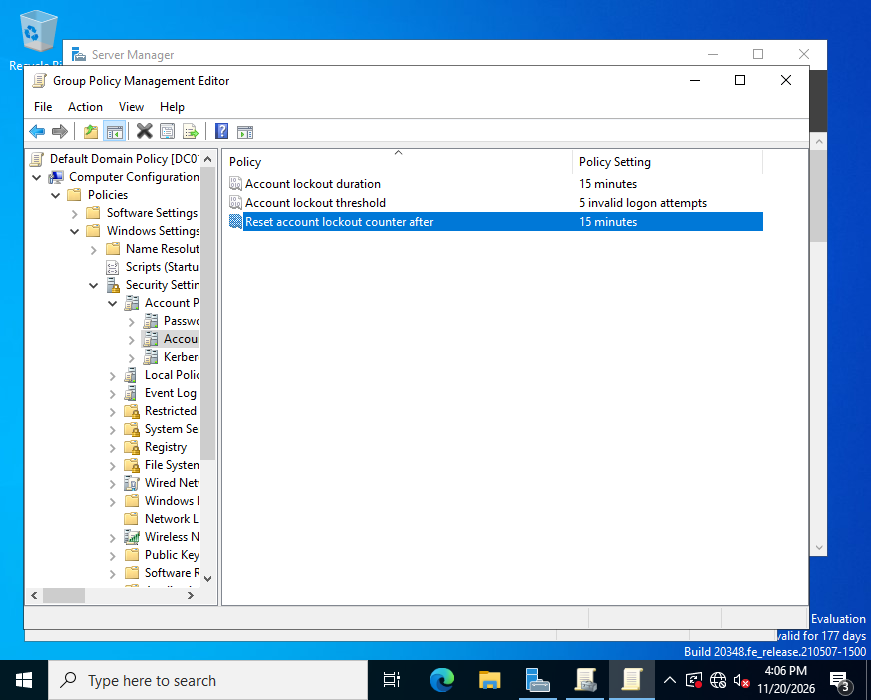
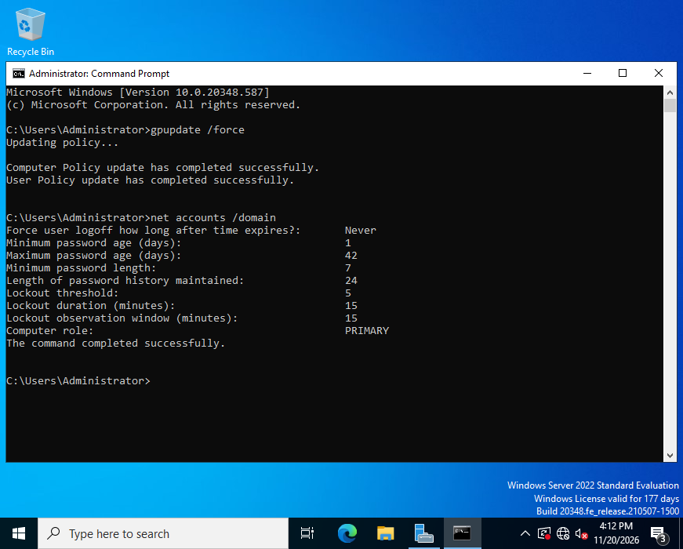
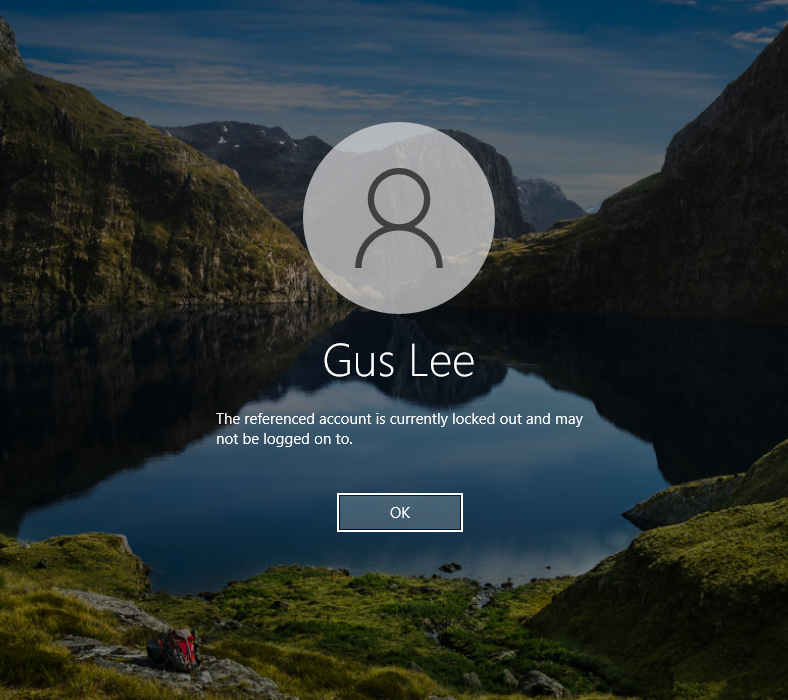
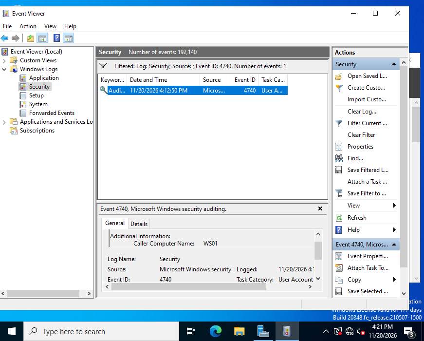
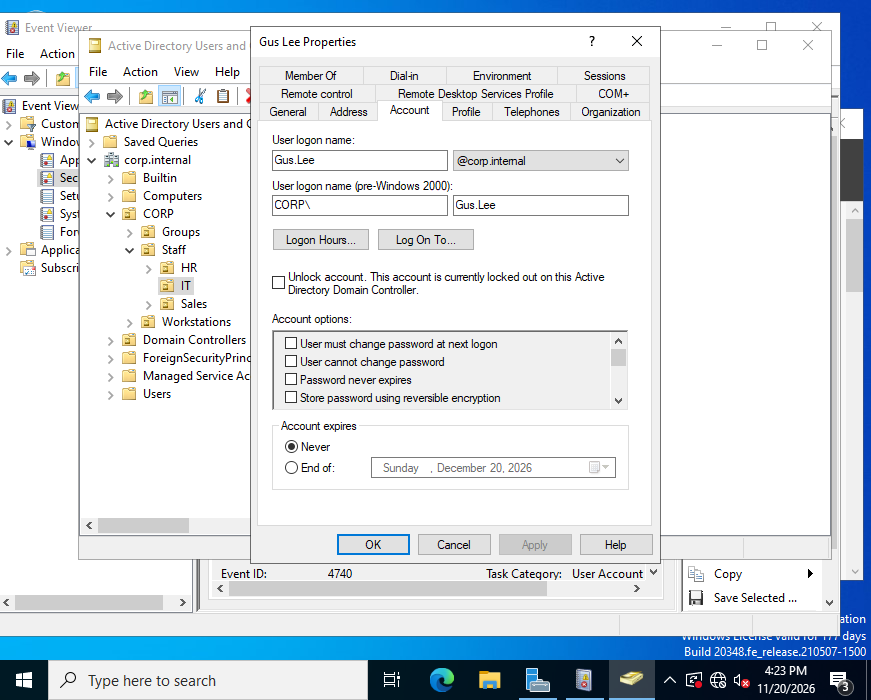

# Ticket #2: Account lockout

## Part A: Setting a lockout policy

I found out a new domain doesn't lock accounts at all by default, so someone could guess passwords forever.
To fix that I edited the Default Domain Policy:

DC01 > Server Manager > Tools > Group Policy Management > corp.internal > right-click **Default Domain Policy** >
Edit, then go to Computer Configuration > Policies > Windows Settings > Security Settings > Account Policies >
Account Lockout Policy.

| Setting | What I set | What it means |
|---|---|---|
| Account lockout threshold | 5 | 5 wrong passwords locks the account |
| Account lockout duration | 15 minutes | it unlocks itself after 15 minutes |
| Reset account lockout counter after | 15 minutes | the wrong-password count goes back to 0 after 15 minutes |

It has to go in the Default Domain Policy (or another policy linked to the whole domain). Lockout settings for
domain accounts don't work in a policy linked to an OU.

To apply it right away instead of waiting, and to check it:

```
gpupdate /force
net accounts /domain
```

`net accounts` showed "Lockout threshold: 5", so the policy was working. It also shows the default password rules,
like passwords expiring after 42 days and needing at least 7 characters.

## Part B: Locking Gus out and unlocking him

I typed the wrong password 5 times on WS01 and got: "The referenced account is currently locked out and may not
be logged on to." After that even the right password doesn't work.

Before unlocking I wanted to see where the bad passwords came from. On a real ticket this matters, because if an
old password is saved on someone's phone or a mapped drive, it can lock them out again right after you unlock them.

DC01 > Event Viewer > Windows Logs > Security > Filter Current Log > Event ID **4740** ("A user account was
locked out"). The Security log had over 190,000 events, so filtering was the only way to find anything.

The event showed Gus.Lee locked out at 4:12 PM, and Caller Computer Name: **WS01**. That's his own PC, which
matches my 5 wrong tries.

To unlock: ADUC > Gus Lee > Properties > Account tab > tick "Unlock account" > OK. Gus signed in fine after that.

## How I'd write it up in a ticket

> **Issue:** Gus Lee locked out, can't sign in to WS01.
> **Checked:** Event 4740 on DC01 shows the lockout came from WS01 (his own PC) at 4:12 PM.
> **Fix:** Confirmed it was Gus, unlocked the account in ADUC. He signed in fine.
> **Cause:** 5 wrong passwords (lockout policy is 5 tries / 15 minutes).

Snapshots on both VMs: `lab5-tickets-1-2`.

---

## Screenshots

**24.** The lockout policy in the Default Domain Policy: 5 tries, 15 minute lockout, counter resets after 15 minutes.



**25.** net accounts /domain shows the lockout threshold is now 5.



**26.** After 5 wrong passwords, Gus is locked out.



**27.** Event 4740 on DC01. Caller Computer Name is WS01, so the bad passwords came from Gus's own PC.



**28.** Unlocking Gus from the Account tab in ADUC.


