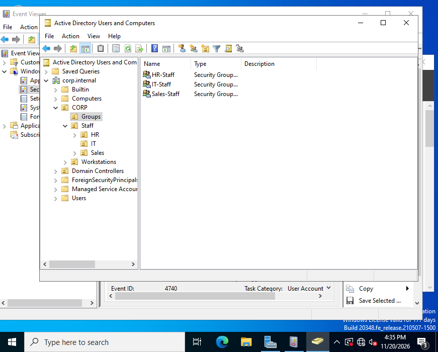
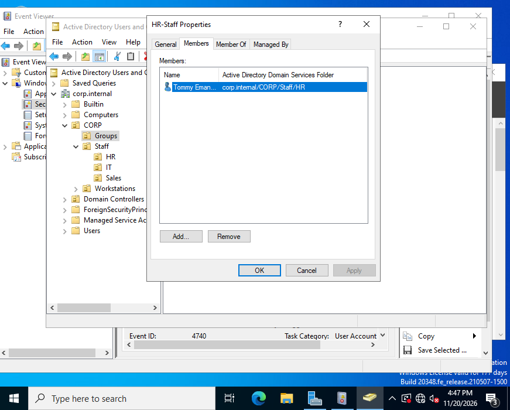
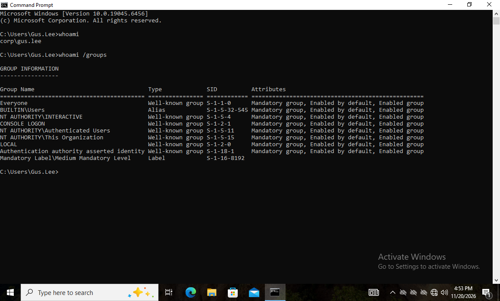
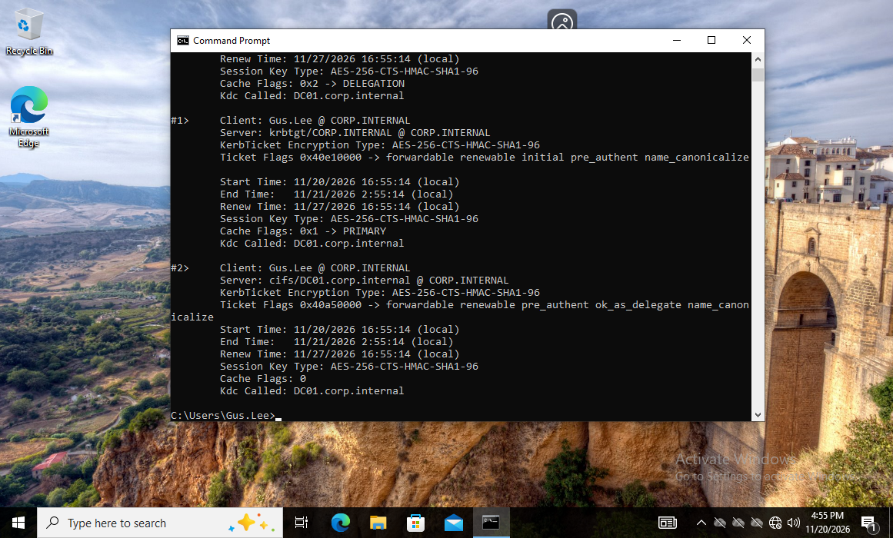
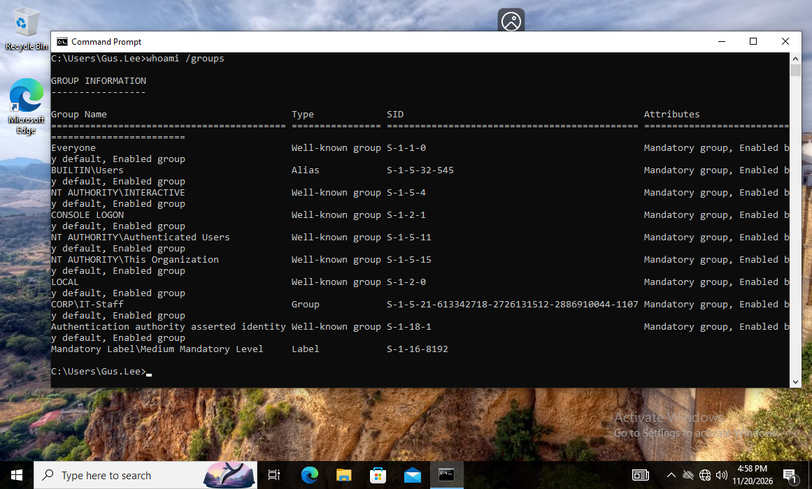

# Ticket #3: Security groups

The idea behind groups: give access to a group, then put people in the group. When someone new starts, you add
them to the group instead of changing permissions on every folder.

## Part A: Create the groups

In ADUC, right-click CORP\Groups > New > Group:

| Group | Scope | Type |
|---|---|---|
| IT-Staff | Global | Security |
| HR-Staff | Global | Security |
| Sales-Staff | Global | Security |

- **Security** groups can be used for permissions. **Distribution** groups are only for email lists.
- **Global** is the normal scope for grouping people by department. I used a different scope (Domain Local) in
  [ticket #4](ticket-04-hr-shared-folder.md).

## Part B: Add the users

Double-click the group > Members tab > Add > type the name > Check Names > OK. Gus went in IT-Staff, Tommy in
HR-Staff and Jason in Sales-Staff.

Something that confused me at first: the **HR OU** and the **HR-Staff group** are two different things.

- The OU is *where the account lives*. An account can only be in one OU.
- The group is *what the account can access*. An account can be in lots of groups.

## Part C: Gus didn't have his new group

I added Gus to IT-Staff while he was signed out. When he signed back in, I ran `whoami /groups` on WS01 and
IT-Staff wasn't there.

What I checked:

| Command | Result | What it told me |
|---|---|---|
| `net user Gus.Lee /domain` | IT-Staff is listed | AD is right, so the problem is on the PC |
| `whoami /groups` | no IT-Staff | Gus's current sign-in has his old groups |
| `klist` | his ticket from the DC was created at 4:55, after he signed in | Windows didn't check with the DC when he signed in |

Turns out Windows 10 doesn't always wait for the network when a user signs in. If the user has signed in
on that PC before, it can sign them in with saved (cached) credentials, and those have the old group list. It
contacted the DC a couple of minutes later, but by then the sign-in was already done.

**Fix:** I signed Gus out and back in. `whoami /groups` showed CORP\IT-Staff.

This seems like a common ticket: "you added me to the group but I still can't get in." The first thing to try
is signing out and back in. There's a Group Policy setting that makes Windows wait for the network at sign-in,
which I want to try next.

---

## Screenshots

**29.** The three department groups in CORP\Groups.

**30.** HR-Staff's members. Tommy is in the group, but his account lives in the HR OU.

**31.** After signing in, whoami /groups doesn't show IT-Staff, even though AD says Gus is in it.

**32.** klist shows Gus's ticket from the DC was created after he had already signed in, so he was signed in with cached credentials.

**33.** After signing out and back in, IT-Staff shows up.

