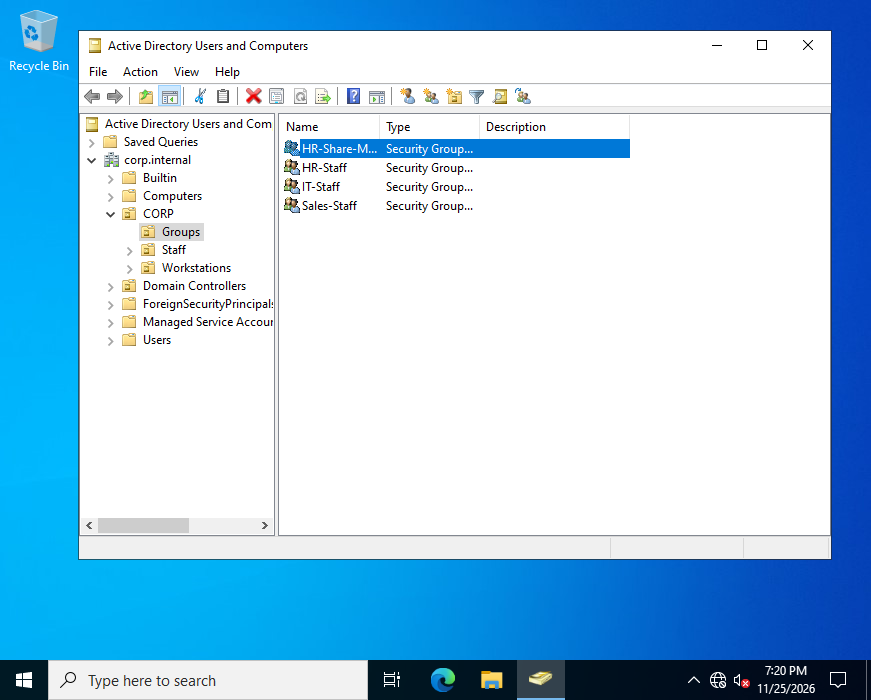
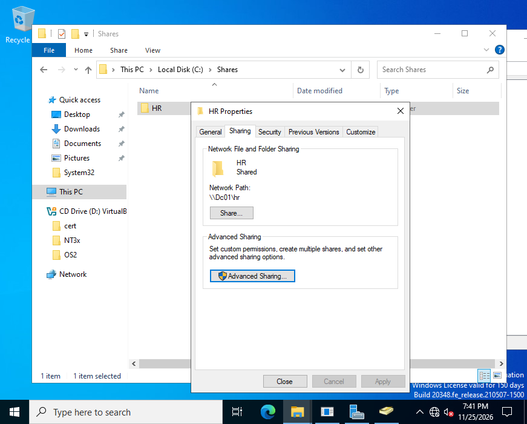
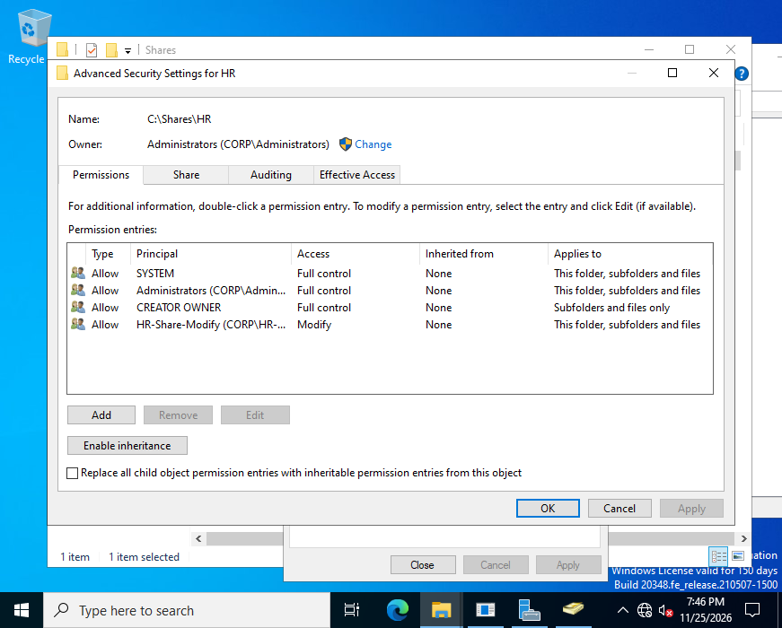
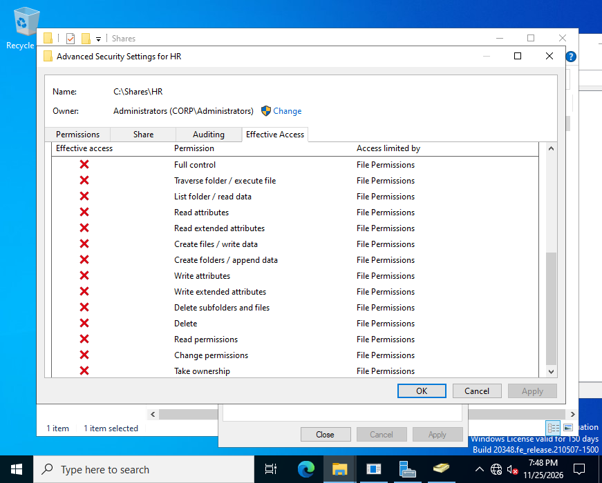
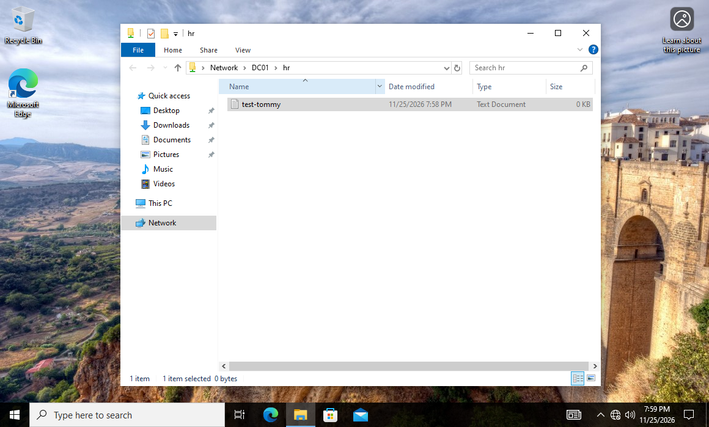
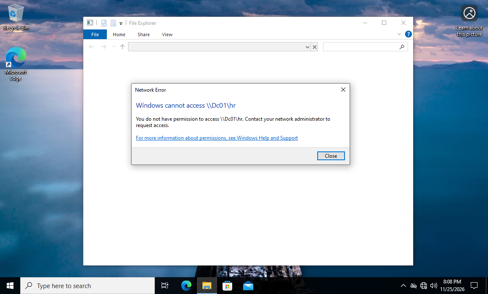

# Ticket #4: HR shared folder

**Ticket:** "HR needs a shared folder that only HR can open."

## How the access works

I set up access in layers instead of giving permissions to people directly:

```
Tommy  ->  HR-Staff  ->  HR-Share-Modify  ->  Modify permission on the HR folder
(user)     (who he is)   (what he can access)
```

This is called AGDLP (Accounts, Global groups, Domain Local groups, Permissions). The point of the extra group is
that if another team needs the folder later, I add their group to HR-Share-Modify and never touch the folder's
permissions.

## Part A: The access group

In ADUC: CORP\Groups > New > Group > `HR-Share-Modify`, scope Domain local, type Security. Then Members
tab > Add > `HR-Staff`. So it's a group inside a group.

> After this, DC01 froze and I had to force it off. See [the incident write-up](../incidents/02-uac-prompt-and-frozen-dc.md).

## Part B: Share the folder

On DC01 I made `C:\Shares\HR`, then Properties > Sharing > Advanced Sharing > Share this folder. For the share
permissions I removed Everyone and added Authenticated Users with Full Control.

That sounds like a lot of access, but there are two layers of permissions on a shared folder:

- **Share permissions** only apply when someone opens it over the network (`\\DC01\HR`).
- **NTFS permissions** (the Security tab) always apply.

Windows uses whichever is stricter. A common setup is to leave the share open and do the real locking down with NTFS.

## Part C: NTFS permissions

By default the folder copies permissions from `C:\`, which lets every domain user read it. So:

1. Security tab > Advanced > Disable inheritance > "Convert inherited permissions into explicit permissions"
2. Removed the Users entries (every domain user is in that group)
3. Kept SYSTEM and Administrators
4. Added HR-Share-Modify with **Modify**

I gave Modify instead of Full Control. Modify lets HR create, edit and delete files. Full Control would also let
them change the permissions, and they don't need that.

## Part D: Check before testing

Advanced Security > Effective Access tab lets you pick a user and see what they'd be allowed to do.

- Tommy (HR): read, write and delete, but not change permissions
- Jason (Sales): denied everything

## Part E: Test from WS01

- I forgot Tommy's test password, so I reset it (ticket #1 again).
- Signed in as Tommy, Win+R > `\\DC01\HR`. The folder opened and I made a test text file. So read and write both work.
- Signed in as Jason, same path: "Windows cannot access \\Dc01\hr. You do not have permission". The share let him
  through, but NTFS blocked him.

## Ticket write-up

> **Request:** HR needs a shared folder only HR can open.
> **Done:** Made group HR-Share-Modify with HR-Staff in it. Created C:\Shares\HR on DC01 and shared it as \\DC01\HR.
> Turned off inheritance, removed Users and gave HR-Share-Modify Modify.
> **Tested:** Tommy (HR) can open the folder and create files. Jason (Sales) gets access denied.

Snapshots on both VMs: `lab5-ticket4-hr-share`.

---

## Screenshots

**34.** HR-Share-Modify, a Domain Local group with HR-Staff as its member.



**35.** C:\Shares\HR shared as \\DC01\HR.



**36.** NTFS permissions after turning off inheritance: SYSTEM, Administrators, CREATOR OWNER and HR-Share-Modify (Modify).



**37.** Effective Access for Jason (Sales): denied on everything.



**38.** Signed in as Tommy (HR), opened \\DC01\HR and made a test file.



**39.** Signed in as Jason (Sales), \\DC01\HR says access denied.


